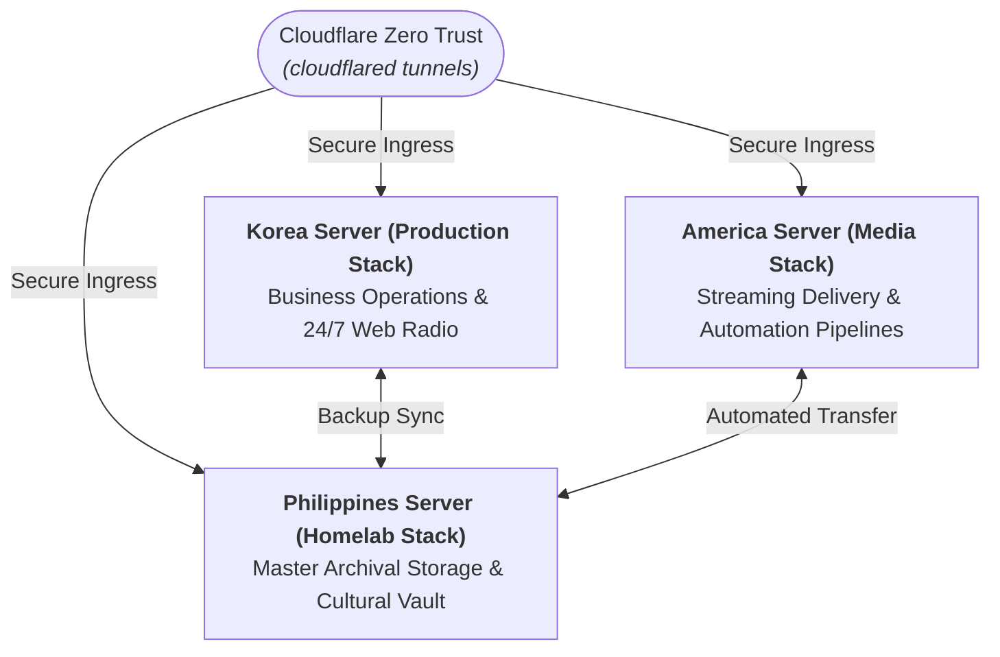

# 🏛️ PinoySeoul Infrastructure Catalogue

Welcome to the central container library for **PinoySeoul Media Enterprise**. This repository acts as the public anchor for our curated container collection, ensuring high availability, security, and standardized deployment across our global multi-node cluster.

## 🚀 Infrastructure Dashboard
Our entire tech stack is managed by an **Automated Mirror Engine** that ensures our containers are always up-to-date and transparently monitored.

| Resource | Status |
| :--- | :--- |
| **Mirror Engine** |  |
| **Live Catalogue** | [📊 View Public Project Board](https://github.com/orgs/pinoyseoul/projects/3) |
| **Public Registry** | [📦 Browse GHCR Packages](https://github.com/orgs/pinoyseoul/packages) |
| **Archival DOI** |  |
| **License** |  |

---

## 🌐 Distributed Server Environments

Our operations run across three coordinated server environments connected through an encrypted Zero Trust network mesh:

### 1. Korea Server (`productionserver`)
* **Role:** Central business services, live digital broadcasting, task management, and operational record keeping.
* **Key Services:**
  * **AzuraCast:** Web radio management and continuous live stream delivery.
  * **Kimai:** Time tracking and professional attendance logging.
  * **Planka:** Visual project management and task boards.
  * **Postiz:** Social media scheduling and multi-channel publication.
  * **Vaultwarden:** Lightweight, self-hosted secret and password management.
  * **Docuseal & InvoiceShelf:** Digital document execution and billing management.

### 2. America Server (`mediaserver`)
* **Role:** Media delivery, content indexing, and digital streaming automation.
* **Key Services:**
  * **Jellyfin:** Primary media server for streaming video content.
  * **Media Automation:** Radarr, Sonarr, Prowlarr, Bazarr.
  * **Jellyseerr:** Discovery and content request pipeline.
  * **qBittorrent & Byparr:** Automated data transmission and acquisition.

### 3. Philippines Server (`homelab`)
* **Role:** On-premise studio infrastructure, master archival storage, and local media services.
* **Key Services:**
  * **Audio & Reading:** Navidrome, Lidarr, Kavita, Readarr, Audiobookshelf, Suwayomi.
  * **Photo Archival:** Photoview for self-hosted, high-resolution photo preservation.
  * **Data Sync:** Syncthing and Rclone routines mirroring data between cloud instances and studio storage.
  * **Studio Management:** CasaOS and Home Assistant for environment telemetry and bare-metal monitoring.

---

## 🛡️ Network Security & Backup Operations

* **Zero Trust Ingress:** Remote communication across servers is handled through Cloudflare Zero Trust tunnels.
* **Service Orchestration:** Stacks are declared through Docker Compose and coordinated via Portainer Server and Portainer Edge Agents.
* **Backup Strategy:** Cloud nodes run automated daily offsite snapshots. The studio storage node runs weekly incremental backups alongside offline cold-storage archives.

---

## 📦 Container Catalogue
The following applications are auto-discovered, mirrored, and tracked in this library.

### 🎬 Media Production & Streaming
*   **azuracast**: The heartbeat of our radio operations. A complete web radio management suite.
*   **jellyfin**: Our primary media streaming server for movies, shows, and live TV.
*   **jellyseerr**: A request management and discovery tool for our media ecosystem.
*   **navidrome**: High-performance music streaming server for our audio library.
*   **audiobookshelf**: Specialized server for managing and streaming audiobooks and podcasts.
*   **photoview**: High-performance photo gallery designed for privacy and large backups.
*   **kavita**: Advanced manga, comic, and ebook management systems.

### 🤖 Media Automation
*   **radarr**: Automated movie collection manager and downloader.
*   **sonarr**: Automated TV series collection manager and downloader.
*   **lidarr**: Automated music collection manager and downloader.
*   **bazarr**: Automated subtitle management and synchronization.
*   **readarr**: Automated book management and downloader.
*   **prowlarr**: Centralized indexer manager for all automation services.
*   **qbittorrent**: High-speed, lightweight torrent client for data transmission.
*   **ytdl-sub**: Automated YouTube content acquisition and organization.

### 💼 Business & Admin Operations
*   **kimai2**: Our core time tracking and professional attendance platform.
*   **planka**: Visual project management and workload tracking board.
*   **postiz-app**: All-in-one social media scheduling and outreach platform.
*   **docuseal**: Secure digital document signing and management.
*   **invoiceshelf**: Self-hosted business invoicing and financial tracking.
*   **vaultwarden**: Secure, lightweight password and secret management (Bitwarden-compatible).

### 🛠️ Technical Infrastructure & Databases
*   **postgres**: Advanced relational database powering our core system services.
*   **mariadb**: Robust SQL database used for high-availability applications.
*   **redis**: High-speed in-memory data store for caching and real-time queues.
*   **elasticsearch**: Distributed search and analytics engine for deep data discovery.
*   **temporalio**: Modern workflow orchestration for reliable task execution.
*   **dbgate**: Cross-platform database manager for SQL and NoSQL clusters.

### 🛡️ Network & System Utilities
*   **cloudflared**: Secure Zero Trust tunnels for private access without open ports.
*   **watchtower**: Automated manager that keeps our containers updated with the latest security patches.
*   **glances**: Real-time system monitoring and hardware metrics dashboard.
*   **rclone**: The "Swiss Army Knife" for cloud storage backups and synchronization.
*   **syncthing**: Continuous file synchronization between our production and studio nodes.
*   **home-assistant**: Centralized automation platform for homelab management.

---

## 📄 License & Attribution

Maintained by **PinoySeoul Media Enterprise**.  
Released under the [MIT License](LICENSE).
